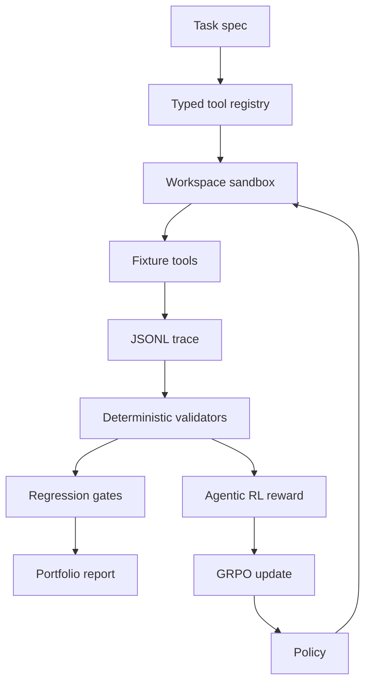

# Sandboxed Tool-Use Agent Evaluation Harness

**Final-answer-only grading overestimated validated correctness by 56.2 percentage points; deterministic validators caught 180 silent failures.**

[](https://github.com/OrrinChen/Sandbox/actions/workflows/sandboxed-agent-eval-harness-ci.yml)


Evidence: offline recorded, fixture-backed, no live API by default. The model profiles are recorded behavior profiles, not a real-time model benchmark.

| Signal | Value |
| --- | ---: |
| Validator gap | 56.2pp validator gap |
| Silent failures | 180 silent failures |
| Benchmark size | 64 tasks |
| Recorded runs | 320 runs |

Recorded-study context, unchanged: 6 domains, 10 deterministic validators (+5 trading-specific validators), 7 failure categories, and 5 recorded profiles.

## Problem

Final-answer-only grading misses silent failures: wrong tool choice, wrong arguments, wrong state mutation, wrong numeric values, unsupported citations, constraint violations, non-replayable traces, timeouts, and cost regressions.

This harness makes those failures visible with typed tools, isolated fixture execution, JSONL traces, deterministic validators, replay, regression gates, and static evidence reports. It is evaluation infrastructure for tool-using agents, not an agent product.

The trading-agent eval domain adds 6 fixture-backed trading tasks over LOB/backtest/risk artifacts. Validators catch lookahead leakage, omitted costs, PnL inconsistency, risk-limit violations, and answers that are not grounded in the artifacts.

## Architecture



```text
task spec -> typed tool registry -> workspace or optional Docker evaluation isolation
-> executable fixture tools -> JSONL trace capture -> deterministic validators
-> trace replay -> regression gates -> portfolio report
```

The same validators are the outcome reward for the Agentic RL extension. Docker support is evaluation isolation and reproducibility support, not a security product.

## Final-answer Grading vs Deterministic Tool-use Validation

| Evaluation mode | What it can see | What it misses |
| --- | --- | --- |
| Final-answer grading | Plausible final answer | tool choice, arguments, state, numbers, citations, constraints, replay |
| Deterministic tool-use validation | tool choice, arguments, state, numbers, citations, constraints, replay | Broader semantic judgment outside the fixture-backed task oracle |

## Quickstart

```bash
make reproduce-report
make ci
```

`make ci` runs pytest, config validation, the oracle smoke evaluation, the strict regression gate, the recorded silent-failure study, report generation, and the CPU Agentic RL smoke. It does not download model weights or call a live API.

## Key Result

Recorded offline study over 64 fixture-backed benchmark tasks and 5 recorded offline model profiles:

```text
Final-answer-only grading overestimated validated correctness by 56.2 percentage points;
deterministic validators caught 180 silent failures.
```

| Item | Value |
| --- | ---: |
| Benchmark tasks | 64 |
| Domains | 6 |
| Recorded model profiles | 5 |
| Runs | 320 |
| Final-answer pass rate | 1.000 |
| Validator pass rate | 0.438 |
| Silent failures | 180 |
| Distinct failure signatures | 5 |

Failure categories caught include tool selection errors, state mutation errors, numeric mismatches, unsupported citations, constraint violations, and final-answer overclaims.

## Reproducibility

```bash
make validate-config
make optional-integrations-smoke
make ci
make portfolio-report
```

Useful outputs:

```text
reports/portfolio_report.md
reports/portfolio_report.json
reports/tables/model_matrix.csv
reports/tables/failure_taxonomy.csv
reports/tables/domain_breakdown.csv
reports/examples/replayable_failure_*.md
```

Default validation is credential-free and network-free. Live provider runs are opt-in only and require explicit `--live` plus credentials.

## Agentic RL

The fixture tasks and deterministic validators are the environment and the reward for GRPO-style post-training of a small open instruct model. Design, split, and the unrun GPU command are in `docs/agentic_rl_design.md`.

Held-out model results are **not yet run**. This table is intentionally empty. Do not read the CPU smoke as a model score.

| Run | Held-out task success | Silent failures | Status |
| --- | --- | --- | ---: |
| Base Qwen2.5-1.5B-Instruct, bare prompt | not yet run | not yet run | needs GPU |
| Prompting-only, tool-use prompt | not yet run | not yet run | needs GPU |
| SFT on train families | not yet run | not yet run | needs GPU |
| GRPO, multi-turn tool use | not yet run | not yet run | needs GPU |

CPU smoke (mocked policy, not a model result):

```bash
make rl-smoke
```

GPU training, after `pip install -e ".[agentic-rl]"` on a CUDA machine:

```bash
python -m sandboxed_agent_eval_harness.rl.train --config configs/agentic_rl.json --backend hf --output-dir artifacts/agentic_rl/qwen25_1p5b_grpo
```

Seed 7 holds out three task families so near-duplicate benchmark clones cannot leak into evaluation: `coding-discount-total-fix`, `data-inventory-stockout-report`, and `optimization-newsvendor-order` (28 tasks). Training uses the other eight families (36 tasks).

## Optional Integrations

The LangChain, LangGraph, LangSmith, and MCP layer is optional adapter infrastructure. It does not replace the harness runner, recorded benchmark evidence, replay gates, or deterministic validators.

```bash
pip install -e ".[ai-integrations]"
make optional-integrations-smoke
```

- LangChain wraps fixture-backed harness tools as adapter tools and keeps JSONL trace events.
- LangGraph `backend="local"` maps plan, tool call, tool result, validate, and retry-or-finish transitions into trace events. `backend="langgraph"` compiles a `StateGraph` with `InMemorySaver` when LangGraph is installed.
- LangSmith writes a local export by default. Upload requires explicit opt-in credentials and is excluded from default CI.
- MCP exposes a fixture-backed MCP `tools/list` and `tools/call` JSON-RPC adapter, maps those calls into the same harness JSONL traces, and keeps no live MCP server by default.

## Limitations

- The benchmark is fixture-backed and deterministic. It is not a live-provider benchmark.
- Recorded model profiles are controlled offline behavior profiles, not claims about specific public providers.
- The final-answer pass metric is a harness proxy, not semantic LLM judging.
- Optional Docker backend is not a security product.
- Live provider workflow is available but excluded from default CI and portfolio evidence unless manually run with credentials.
- Agentic RL model comparisons in the table above are not yet run. The CPU smoke checks the loop with a mocked policy. It is not a Qwen, SFT, or GRPO result.
- The reward can fall by refusing to answer. Eval reports that as `refusal_hack` or `reward_without_success`. Task success and silent-failure counts are the metrics that matter.
- The initial suite and the trading suite are excluded from the RL split. The initial tasks are templates of the benchmark families. Trading is a separate domain.

## Portfolio Materials

- Public report: `reports/portfolio_report.md`
- Agentic RL design: `docs/agentic_rl_design.md`
- Replay walkthrough: `docs/replayable_failure_walkthrough.md`
- Architecture notes: `docs/architecture.md`
- Interview notes: `docs/interview_notes.md`
- Limitations: `docs/limitations.md`
- Failure case studies: `docs/failure_case_studies.md`
- Trading-agent eval notes: `docs/trading_agent_eval.md`

Resume bullet:

> Extended a deterministic LLM tool-use eval harness with a trading-agent evaluation domain over LOB/backtest/risk artifacts; validators catch answer-only grading failures from lookahead leakage, omitted costs, PnL inconsistency, risk-limit violations, artifact grounding gaps, tool misuse, and state mutation errors while preserving fixture-backed replay, CI gates, and offline recorded evidence.

The harness evidence above is frozen. The Agentic RL extension adds the training loop and does not replace those recorded numbers.
